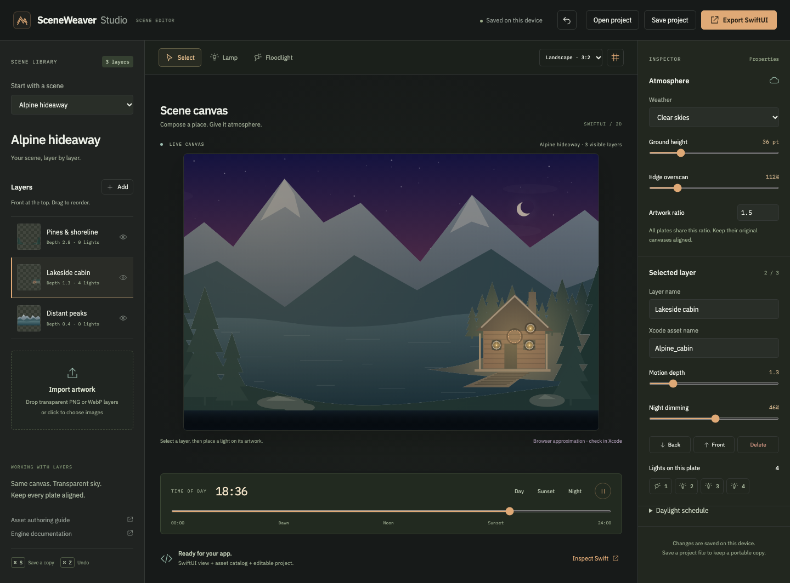
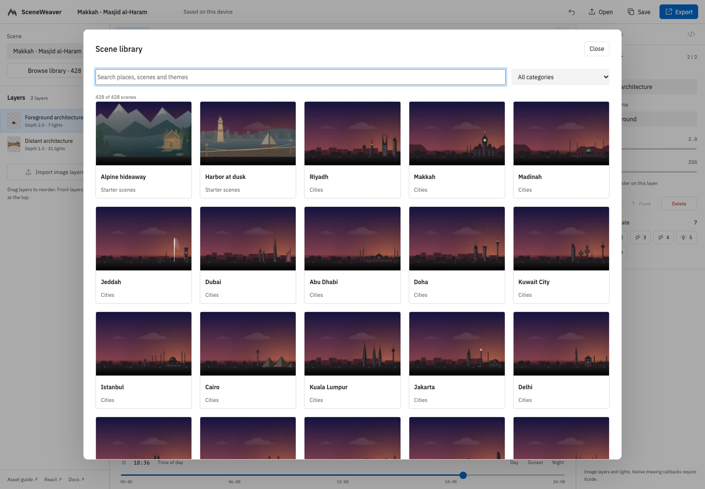
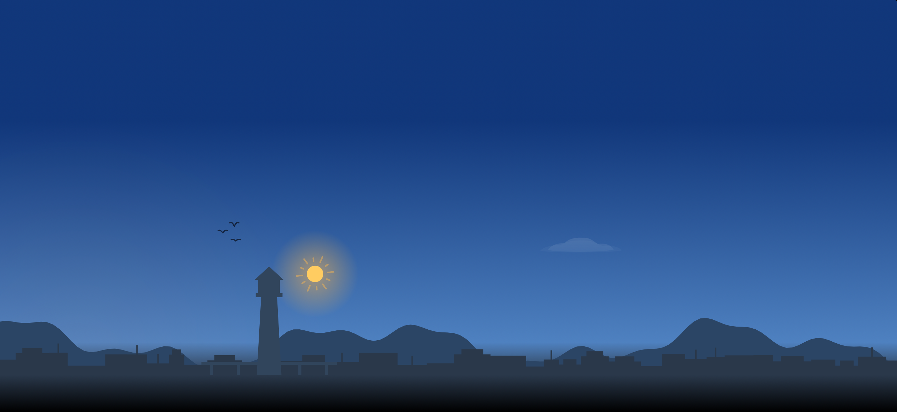
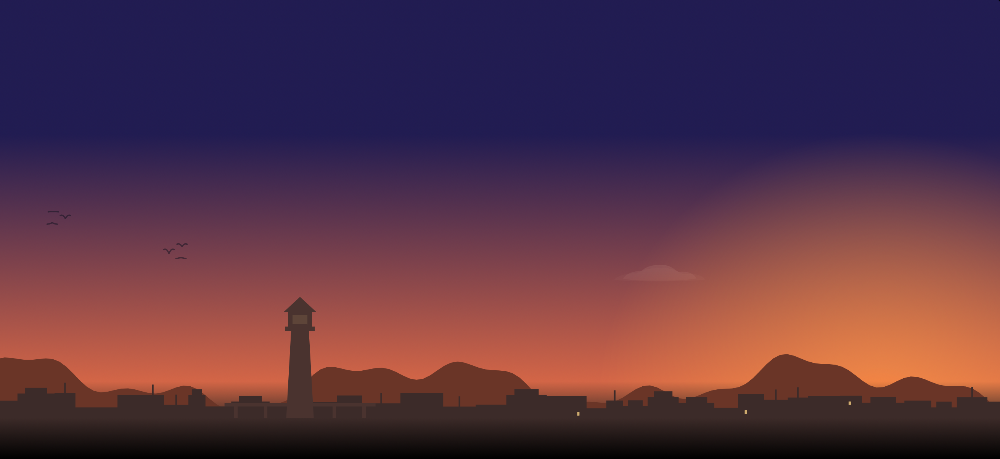
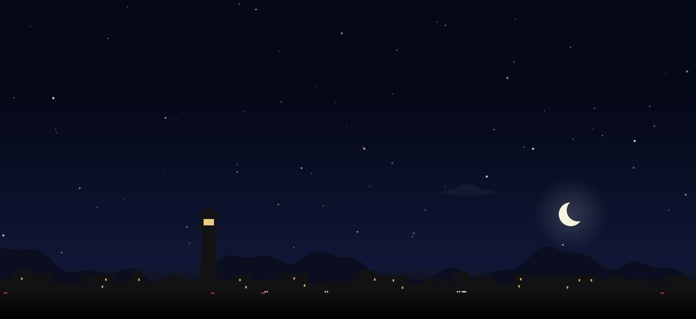
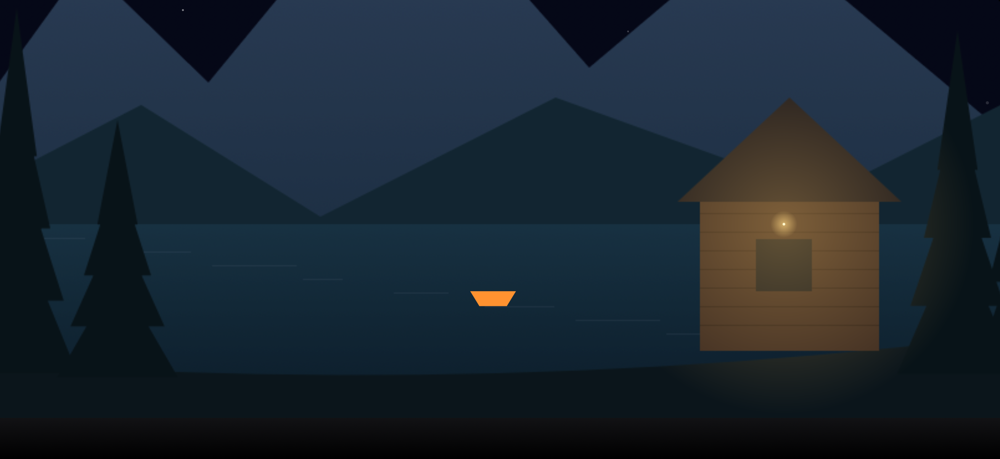

# SceneWeaver

A SwiftUI scene engine for places, landscapes and imagined worlds.

Combine live skies, weather, vector drawings and layered artwork in one Canvas-based composition. Use it for a city, forest, harbor, game backdrop, travel card or your own illustrated world.

- Smooth daylight, sunset and night palettes, sun position, stars and moon.
- Clouds, birds, aircraft, rain, snow, fog and thunderstorms.
- Vector silhouettes, openings, material gradients, windows and blinking beacons.
- Ordered transparent image and Canvas layers with subtle depth motion.
- Alpha-clipped floodlighting and lamps that illuminate after dusk.
- Reduce Motion support and optional RTL landmark repositioning without reflection.
- Independent core engine; optional full scene catalog. No location access or analytics.

Requires **iOS 17+** or **macOS 14+**, Swift 5.9+. MIT licensed.

## Browser configurator

**[Open SceneWeaver Studio →](https://joinalahmed.github.io/SceneWeaver/)**

Compose scenes visually: import aligned artwork, reorder layers, place and drag lamps or floodlights, and tune depth, framing, weather and daylight. Save portable projects, then export a ZIP with SwiftUI code and an Xcode asset catalog. Your artwork stays in the browser.



Browse all **428 original scenes**, including cities, surah and dua scenes, landscapes, and the detailed Makkah/Madinah illustrations. The 421 procedural scenes execute their original Swift recipes live through WebAssembly. Studio and React share the same renderer and assets. [Parity and distribution details](docs/parity.md). No account or build step is needed. [Run locally and read the workflow](studio/README.md).



## React component

Use the shared web renderer in a React 18 or 19 app:

```tsx
import { SceneView } from 'sceneweaver-react';

<SceneView project="/scenes/my-project.json" hour={18.6} weather="clear" />
```

**[React playground →](https://joinalahmed.github.io/SceneWeaver/react/)** · [Installation and component API](packages/react/README.md)

The package accepts Studio JSON projects and includes TypeScript declarations, controlled time/weather, loading and error callbacks, accessible overlays and lifecycle cleanup. Install its built tarball from the React GitHub release; it is not yet on the npm registry.

## Screenshots

Captured from the running iOS example, using only code-drawn content.

| Daylight | Sunset |
| --- | --- |
|  |  |
| **Night lighting** | **Layered artwork** |
|  |  |

## Install

In Xcode, choose **File → Add Package Dependencies** and enter:

```
https://github.com/joinalahmed/SceneWeaver
```

Or add the package and product in `Package.swift`:

```swift
.package(url: "https://github.com/joinalahmed/SceneWeaver.git", from: "0.2.0")
// In your target's dependencies:
.product(name: "SceneWeaver", package: "SceneWeaver")
```

## Full scene library

Add the optional `SceneWeaverCatalog` product to your target, then use:

```swift
import SceneWeaverCatalog

SceneCatalogGallery() // Search all 428 scenes
SceneCatalogView(id: "london", hour: 19)
```

React exports `SceneLibrary`, `ScenePen` and `ScenePath` alongside `SceneView`. Download the full library archive from [v0.2.0](https://github.com/joinalahmed/SceneWeaver/releases/tag/v0.2.0) to host the same assets in your own app. See [React integration](packages/react/README.md).

## Draw a scene

Supply six increasing local dates: dawn, sunrise, noon, afternoon, sunset and nightfall. The engine interpolates its palette around those transitions. It does not calculate astronomical events; use your preferred source, or supply a creative timeline. Invalid schedules fall back to a night sky.

```swift
import SwiftUI
import SceneWeaver

struct CoastalScene: View {
    let schedule: DaylightSchedule

    private var town: SceneDefinition {
        SceneDefinition(backdrop: .hills, wild: false, draw: { pen in
            pen.at(pen.width * 0.7)
            pen.block(0, 24, 85)
            pen.shape([(-17, 85), (17, 85), (0, 105)])
            pen.block(0, 12, 8, from: 72, .light)
            pen.beacon(0, 105)
        })
    }

    var body: some View {
        TimelineView(.periodic(from: .now, by: 60)) { clock in
            SceneView(schedule: schedule, now: clock.date,
                      weather: .partlyCloudy, scene: town)
        }
        .frame(height: 320)
        .clipped()
    }
}
```

`now` controls the displayed sky and clock date. Omit it to update the displayed sky automatically every minute, or supply a fixed date to preview any hour. Animation seconds advance independently. Geometry is drawn in points: `at(_:)` places the pen relative to the right edge, while positive Y rises above the horizon.

Set `wild: true` for a landscape without incidental buildings, birds, aircraft or traffic. Set `ownMoon: true` when your composition draws its own moon. `illustrated: true` selects a warmer foreground material palette. Set `movesForRTL: true` for compact landmarks that should move to the left margin in a right-to-left layout.

## Layer your own artwork

Export aligned transparent plates at the same size and aspect ratio. Load them from **your app's** asset bundle. Put a Canvas layer between plates for people, boats, fireflies or any other moving content. The array order controls occlusion.

```swift
let artwork = LayeredArtwork(layers: [
    .image(ArtworkLayer(image: Image("DistantForest"), depth: 0.5)),
    .canvas(depth: 1) { context, rect, frame in
        // Draw actors here. rect maps normalized artwork coordinates to Canvas.
        // frame.time is zero under Reduce Motion; frame.date stays meaningful.
    },
    .image(ArtworkLayer(image: Image("Cabin"), depth: 2,
        floodlights: [ArtworkLight(x: 0.6, y: 0.7)])),
    .canvas(depth: 2) { context, rect, frame in
        SceneLamp(x: 0.6, y: 0.7).draw(in: &context, rect: rect, frame: frame)
    }
], aspectRatio: 1.5)

let forest = SceneDefinition(render: { context, frame in
    artwork.draw(in: &context, frame: frame)
})
```

The default 12% overscan fills both sides during subtle depth motion. Give all plates the same authored aspect ratio; keep essential content away from the overscan edges. `ArtworkLayout.rect` is also available for custom compositors. Very large custom depth offsets may require more overscan. Clip your scene view to its intended viewport.

For more control, `SceneDefinition.render` replaces the geometry renderer and `overlay` draws above it, before precipitation. Both receive a `SceneFrame` with dimensions, horizon, time, displayed date, darkness and sunset glow. The host owns artwork decoding and caching; load images outside per-frame drawing callbacks.

## Examples and development

[Examples/SceneWeaverGallery.swift](Examples/SceneWeaverGallery.swift) includes a coastal town and a composition using three content layers. It creates and caches its transparent illustration plates from code, so no image downloads are required. Copy the view into a SwiftUI app linked to the package, or open the package in Xcode to use its preview.

```sh
swift test
swift build --target SceneWeaverExamples
xcodebuild -scheme SceneWeaver \
  -destination 'generic/platform=iOS Simulator' CODE_SIGNING_ALLOWED=NO build
```

Regenerate the screenshots on an Apple Silicon Mac with Xcode and an available iOS simulator runtime:

```sh
python3 scripts/capture-screenshots.py
```

The script builds a temporary app using the example scene without its gallery controls and captures four unmodified landscape PNGs on a dedicated simulator named `SceneWeaver Screenshots`. It leaves that simulator available for inspection. The screenshots show fixed displayed hours; ambient motion remains live.

The package targets iOS first and also builds on macOS for previews and geometry tests. It is a decorative 2D renderer, not a physics or 3D game engine. Canvas content is accessibility-hidden; place meaningful labels and controls in the host UI. The default animation interval is 24 fps; profile your own artwork and custom layers on your target devices.

## For coding agents

- [Scene integration skill](SKILL.md): build and modify native SceneWeaver compositions.
- [Asset creation skill](skills/sceneweaver-assets/SKILL.md): turn a scene requirement into aligned plates, lighting coordinates and a Studio catalog entry.


Read [SKILL.md](SKILL.md) when integrating SceneWeaver or authoring a scene. The guide covers API selection, coordinate systems, layer occlusion, lighting, time, accessibility and validation. Tools that support `SKILL.md` can use this repository as the skill directory.

## Origin and contributions

SceneWeaver was extracted from an existing SwiftUI app. Its original app models, location selection, themed scene catalogs and generated illustrations are intentionally outside this repository. The public engine is general purpose; the geometry and artwork you supply determine its subject.

Issues and focused pull requests are welcome. Include a small reproducible scene for rendering bugs. See [CONTRIBUTING.md](CONTRIBUTING.md).
